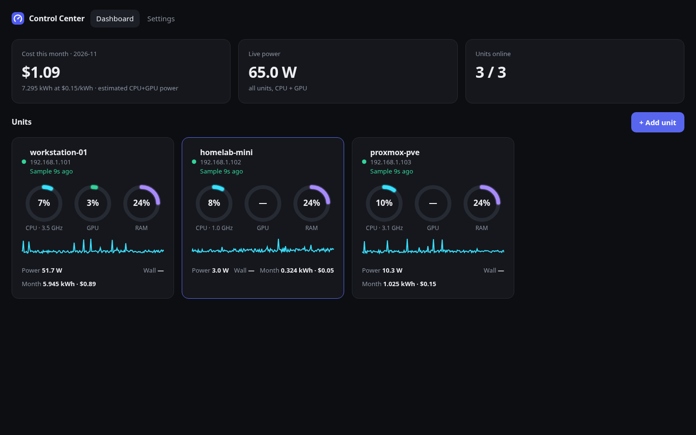
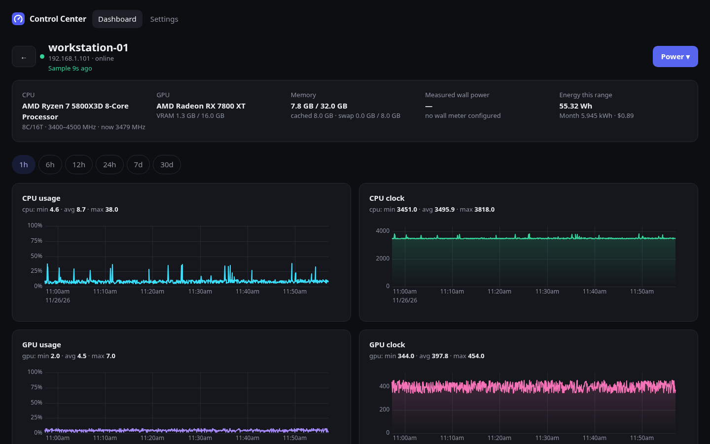
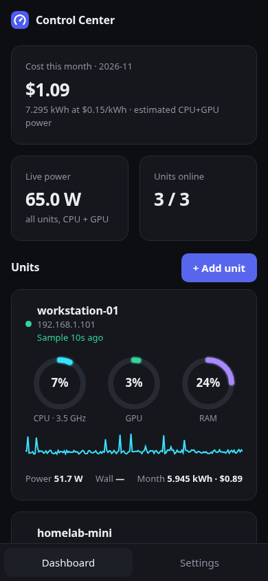

# Control Center

[](https://github.com/tunitz/control-center/actions/workflows/ci.yml)
[](https://github.com/tunitz/control-center/actions/workflows/release.yml)
[](LICENSE)
[](https://github.com/tunitz/control-center/pkgs/container/control-center)
[](https://bun.sh/)

A dark-first fleet monitoring, service control, and power-cost dashboard for Linux hosts over SSH with a lightweight bash agent. Built with **Bun + SQLite** on the server and **React + uPlot** in the browser, protected by a single admin login.



## Features

- **Fleet dashboard & telemetry**: Hero cost/power/online cards, per-unit gauges, sparklines, and multi-tier (`1h` raw, `6h–24h` 1m, `7d–30d` 15m) uPlot charts with explicit stale-sample age labels.
- **Agent diagnostics**: Checks reachability, sample freshness, pinned SSH host keys, static hardware info, service allowlist sync, and port migration, with live `info` probes and Reconnect.
- **Service allowlist control**: Discover `systemd`, user `systemd`, `docker`, and `lxc` units, enforce an explicit allowlist with `synced` status and Reconcile, inspect logs, and run start/stop/restart actions.
- **Power management**: Shutdown, restart, and Wake-on-LAN actions that honestly distinguish `accepted` from `delivery_unknown`.
- **Alerts & maintenance windows**: Per-unit offline, stale, and disk-usage alerts with weekday/minute suppression windows (supporting midnight wrap).
- **Energy & configurable regional billing**: Daily kWh and cost history with CSV export (`day,kwh,cost`), monthly rollover rates, optional measured wall-power input (`POST /api/metrics/wall`), and configurable IANA timezone and currency (defaults: `UTC`, `USD` / `$`).
- **Backups & security**: Consistent WAL-safe SQLite backups and transactional restore with `CC_MASTER_KEY` separation, first-contact SSH host-key pinning, encrypted per-unit ed25519 keys, argon2id sessions, CSRF headers, rate limiting, and a 365-day audit log.

## Screenshots

| Unit Detail & uPlot Charts | Mobile Dashboard |
| :---: | :---: |
|  |  |

## Architecture

```text
Browser  <──(HTTPS / cc_session + x-cc: 1)──>  Control Center (Bun + SQLite)  ──(Outbound SSH :62478)──>  Linux Units (ccagent)
```

Control Center connects **outward** to managed units over a dedicated key-only `sshd` on port `62478` (configurable). Managed units never need inbound access back to Control Center.

## Quick Start

### 1. Docker Compose (Recommended)

The Alpine image (`ghcr.io/tunitz/control-center`) runs with `network_mode: host` so Wake-on-LAN broadcasts reach your LAN and units are reachable by IP:

```bash
git clone https://github.com/tunitz/control-center.git && cd control-center
cp .env.example .env
# Edit .env and set a persistent CC_MASTER_KEY plus CC_ADMIN_PASSWORD (or CC_BOOTSTRAP_TOKEN).
docker compose pull
docker compose up -d
```

To build locally instead of pulling from GHCR:

```bash
docker compose -f compose.yaml -f compose.build.yaml up -d --build
```

### 2. Prebuilt Release Binaries

Download the archive for your platform (`linux-x64`, `darwin-arm64`, `windows-x64`) and `SHA256SUMS.txt` from [GitHub Releases](https://github.com/tunitz/control-center/releases):

```bash
sha256sum -c SHA256SUMS.txt --ignore-missing
tar -xzf control-center-*-linux-x64.tar.gz && cd control-center
CC_MASTER_KEY='<long-random-string>' \
CC_BOOTSTRAP_TOKEN='<at-least-8-chars>' \
CC_DATA="$PWD/data" CC_WEB="$PWD/apps/web/dist" CC_AGENT_DIR="$PWD/agent" \
./control-center
```

### 3. From Source

Requires **[Bun](https://bun.sh/) 1.4+**:

```bash
git clone https://github.com/tunitz/control-center.git && cd control-center
bun install --frozen-lockfile
bun run build:web
CC_MASTER_KEY='<long-random-string>' CC_BOOTSTRAP_TOKEN='<at-least-8-chars>' bun run start
```

Open `http://<this-host>:3030` and complete first-run setup (or sign in if `CC_ADMIN_PASSWORD` was set).

> **Important:** `CC_MASTER_KEY` encrypts per-unit SSH private keys at rest and is **never** included in SQLite backups. Keep a durable separate copy of `CC_MASTER_KEY`; losing it requires re-keying every unit. See [docs/operations.md](docs/operations.md#backup-and-restore).

## Add a Unit

1. Open **Dashboard → + Add unit** (name, host/IP, optional MAC for Wake-on-LAN). Control Center generates a unique ed25519 key pair and encrypts the private half at rest.
2. Copy the unit installer command (short `curl`, offline paste, or script download) from **Install** and run it as root on the Linux host.
3. The unit appears online within one poll interval.

See [docs/operations.md](docs/operations.md#units) for key rotation, legacy port-22 migration, and unit removal.

## Documentation

- [docs/installation.md](docs/installation.md) — Requirements, environment variables, first-run setup, Docker/binary/source runs
- [docs/operations.md](docs/operations.md) — Adding units, service allowlist control, alerts, backups, and audit log
- [docs/api.md](docs/api.md) — HTTP API reference
- [docs/data-and-cost.md](docs/data-and-cost.md) — Retention tiers, RAPL/GPU/wall energy accounting, regional timezone & CSV export
- [docs/development.md](docs/development.md) — Build, test, and mobile-width UI verification
- [docs/troubleshooting.md](docs/troubleshooting.md) — Diagnostics, nftables discovery, and restore troubleshooting
- [deploy/README.md](deploy/README.md) — Production deployment notes

## Security

The unit installer authorizes a forced-command SSH key restricted to `read`, `ack`, `info`, allowlisted `svc-*`, and `power` verbs, protecting `ccagent*`, `ssh`, and `sshd` units. Login is rate-limited with argon2id and an `HttpOnly`, `SameSite=Strict` cookie; all writes require `x-cc: 1`, and changing the password revokes all active sessions. Always terminate TLS at a reverse proxy when exposing Control Center beyond a trusted network. See [SECURITY.md](SECURITY.md) for vulnerability reporting.

## Contributing

Contributions are welcome — see [CONTRIBUTING.md](CONTRIBUTING.md) for guidelines and checks:

```bash
bun run typecheck && bun test && bun run build:web && bun run build:server:bundle && bash tools/check_docs.sh
```

## License

[MIT](LICENSE) © 2026 tunitz
